<picture>
  <source media="(prefers-color-scheme: dark)" srcset="docs/banner-dark.svg">
  
</picture>

**fidel** is a small, dependency-free Python library for cleaning and working with Amharic text written in Ge'ez script (ፊደል).

Amharic text from the web is messy. One sound can be written with several letters (ሀ / ሐ / ኀ, ሰ / ሠ, አ / ዐ, ጸ / ፀ). Writers spell labialized syllables in different ways (ቱዋ vs ቷ). The ፡ word separator, `፡፡` used in place of `።`, and Ethiopic numerals all trip up general-purpose tokenizers. `fidel` handles these problems with small, tested functions.

## Install

```bash
pip install git+https://github.com/tofiqueadam/fidel
```

## Tour

```python
>>> import fidel

>>> fidel.normalize("ሐይለ ሥላሴ፡፡")             # fold homophone letters, fix punctuation
'ሀይለ ስላሴ።'

>>> fidel.words("ሰላም፡ዓለም፣ በ፳፻፲፮ ዓ.ም.")       # ፡ separates words
['ሰላም', 'ዓለም', '፣', 'በ', '፳፻፲፮', 'ዓ', '.', 'ም', '.']

>>> fidel.sentences("ሰላም ነህ? ደህና ነኝ።")
['ሰላም ነህ?', 'ደህና ነኝ።']

>>> fidel.romanize("ኢትዮጵያ")                     # lossless, SERA-style
"'ityoPya"
>>> fidel.to_fidel("qWanqWa")
'ቋንቋ'

>>> fidel.to_ethiopic(2016), fidel.from_ethiopic("፲፪፼፴፬፻፶፮")
('፳፻፲፮', 123456)

>>> s = fidel.syllable("ቋ")                      # every letter = consonant row + vowel order
>>> s.base, s.vowel, s.kind
('ቀ', 'wa', 'labio')
>>> " ".join(fidel.row("ለ"))
'ለ ሉ ሊ ላ ሌ ል ሎ ሏ'

```

## Command line

```bash
$ fidel normalize "ሐይለ ሥላሴ፡፡"
ሀይለ ስላሴ።
$ fidel romanize ኢትዮጵያ
'ityoPya
$ fidel num 2016 ፻፼
፳፻፲፮
1000000
$ fidel split ቋንቋ
ቋ  ቀ + wa   order 4  labio
ን  ነ + ə    order 6  plain
ቋ  ቀ + wa   order 4  labio
```

Each command reads from stdin when you leave out the text, so `cat corpus.txt | fidel normalize > clean.txt` works.

## Normalization levels

| Level | What it does | Example |
|---|---|---|
| `light` | Unicode NFC, `፡፡` → `።`, whitespace cleanup | `ሰላም፡፡` → `ሰላም።` |
| `standard` *(default)* | + homophone rows folded (ሐ ኀ→ሀ, ሠ→ሰ, ዐ→አ, ፀ→ጸ), spelled-out labials joined | `ቱዋ` → `ቷ` |
| `aggressive` | + ኸ→ሀ, 1st/4th order merged for ሀ and አ, `፡` → space | `ሓ ኣ ዓ` → `ሀ አ አ` |

Use `standard` for search and deduplication. Use `aggressive` only when you need maximum recall and can accept losing a spelling distinction.

## Transliteration scheme

The romanization follows the conventions of [SERA](https://en.wikipedia.org/wiki/SERA_(transliteration)):

| Vowel order | 1 | 2 | 3 | 4 | 5 | 6 | 7 |
|---|---|---|---|---|---|---|---|
| sound | ä | u | i | a | e | ə | o |
| Latin | `e` | `u` | `i` | `a` | `E` | *(none)* or `I` | `o` |

Capital letters mark ejectives and extra consonants (`T` ጠ, `C` ጨ, `P` ጰ, `S` ጸ, `N` ኘ, `Z` ዠ). A backtick marks the historical homophone rows (`` `s `` ሠ, `` `h `` ኀ, `` `S `` ፀ, `` ` `` ዐ). An apostrophe `'` marks the glottal row አ. `W` marks labialization (`lWa` ሏ, `qWa` ቋ). `to_fidel(romanize(x)) == x` holds for any supported text, and the tests check this on thousands of random strings.

## Ethiopic numerals

Ethiopic numerals have no zero and no place value. A number is written as pairs of digits joined by ፻ (100) and ፼ (10,000): `123456` = ፲፪ ፼ ፴፬ ፻ ፶፮. `fidel` converts in both directions for any positive integer. `replace_numerals()` rewrites every Ethiopic numeral in a text with Arabic digits.

## How it's built

- **Character tables are checked against the Unicode database.** The source only lists the first character of each consonant row. Every other character is derived from it and checked against Python's `unicodedata` at import time, so a wrong code point raises an error instead of producing silently wrong output.
- **Property tests.** Numerals round-trip for every integer from 1 to 120,000 and for 5,000 random integers up to 10²⁴. Transliteration round-trips on thousands of random strings. Every normalization level is idempotent (running it twice gives the same result).
- **No dependencies.** Pure Python, standard library only.

## Roadmap

- [ ] Rows used by Tigrinya and Ge'ez (Ethiopic Extended blocks)
- [ ] A browser playground
- [ ] An Amharic LLM benchmark: how well do current models read, write and transliterate Amharic?
- [ ] PyPI release

Contributions are welcome, especially from native speakers who can point out normalization rules that don't fit real-world usage.

## License

MIT © Tofique Adam
